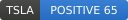

# Dashboard

**Session:** 2026-11-02 · **Source file:** `reports/market_report_20261102.csv` · regenerated automatically after each U.S. close.

> Signals describe how well today's price, volume and trend line up. They are not
> buy/sell recommendations and not evidence of institutional activity. Whether they
> carry any forward-looking information is tested separately in [evaluation.md](evaluation.md).

## Latest signals

| Ticker | Badge | Score | Close | 1d | 5d vs SPY | RVOL20 | RSI14 | vs 20d high | ATR % |
|---|---|---:|---:|---:|---:|---:|---:|---:|---:|
| **TSLA** |  | 77.9 | 403.82 | +1.0% | +4.8% | 1.19 | 62.5 | -1.7% | +3.4% |
| **VRT** |  | 15.7 | 224.24 | -3.6% | +14.0% | 0.85 | 47.8 | -13.1% | +6.4% |
| **KLAC** |  | 11.8 | 153.11 | -3.0% | +4.3% | 1.29 | 37.3 | -26.3% | +5.4% |
| **SPCX** |  | 11.7 | 136.37 | +1.2% | -5.4% | 0.87 | 39.2 | -22.7% | +5.5% |
| **ALAB** |  | 4.5 | 229.67 | -11.2% | -9.8% | 1.33 | 32.0 | -42.8% | +10.5% |

## Score breakdown

Points earned per component. When an input is unavailable (for example no 200-day EMA yet
after an IPO), that part is left out and the score is re-normalised; *Coverage* shows the share
of the 100 points that could be computed. Below 60% the label is
*INSUFFICIENT DATA*.

| Ticker | Trend (/25) | Volume (/25) | Breakout (/20) | Momentum (/15) | Relative Strength (/15) | Coverage |
|---|---:|---:|---:|---:|---:|---:|
| TSLA | 25.0 | 13.0 | 11.3 | 13.9 | 14.7 | 100% |
| VRT | 0.0 | 1.8 | 0.0 | 7.4 | 6.6 | 100% |
| KLAC | 0.0 | 3.7 | 0.0 | 2.6 | 5.6 | 100% |
| SPCX | 0.0 | 7.4 | 0.0 | 3.2 | 0.0 | 91% |
| ALAB | 0.0 | 3.8 | 0.0 | 0.7 | 0.0 | 100% |

## Label scale

| Label | Score |
|---|---|
| STRONG PRICE/VOLUME | 75–100 |
| POSITIVE | 60–74.9 |
| WATCH | 45–59.9 |
| WEAK | below 45 |
