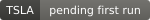

# Dashboard

**Session:** 2026-10-22 · **Source file:** `reports/market_report_20261022.csv` · regenerated automatically after each U.S. close.

> Signals describe how well today's price, volume and trend line up. They are not
> buy/sell recommendations and not evidence of institutional activity. Whether they
> carry any forward-looking information is tested separately in [evaluation.md](evaluation.md).

## Latest signals

| Ticker | Badge | Score | Close | 1d | 5d vs SPY | RVOL20 | RSI14 | vs 20d high | ATR % |
|---|---|---:|---:|---:|---:|---:|---:|---:|---:|
| **TSLA** |  | 49.4 | 374.58 | -3.1% | +4.4% | 1.44 | 52.8 | -3.7% | +3.4% |
| **SPCX** |  | 27.5 | 144.75 | -9.1% | -1.6% | 2.10 | 44.5 | -18.0% | +5.7% |
| **KLAC** |  | 6.2 | 147.83 | -9.5% | -14.2% | 2.19 | 24.1 | -29.2% | +5.6% |
| **ALAB** |  | 5.7 | 257.82 | -11.1% | -13.6% | 1.63 | 32.1 | -35.8% | +9.2% |

## Score breakdown

Points earned per component. When an input is unavailable (for example no 200-day EMA yet
after an IPO), that part is left out and the score is re-normalised; *Coverage* shows the share
of the 100 points that could be computed. Below 60% the label is
*INSUFFICIENT DATA*.

| Ticker | Trend (/25) | Volume (/25) | Breakout (/20) | Momentum (/15) | Relative Strength (/15) | Coverage |
|---|---:|---:|---:|---:|---:|---:|
| TSLA | 16.0 | 4.3 | 8.1 | 11.1 | 9.9 | 100% |
| SPCX | 8.0 | 6.2 | 0.0 | 5.1 | 5.7 | 91% |
| KLAC | 0.0 | 6.2 | 0.0 | 0.0 | 0.0 | 100% |
| ALAB | 0.0 | 5.0 | 0.0 | 0.7 | 0.0 | 100% |

## Label scale

| Label | Score |
|---|---|
| STRONG PRICE/VOLUME | 75–100 |
| POSITIVE | 60–74.9 |
| WATCH | 45–59.9 |
| WEAK | below 45 |
