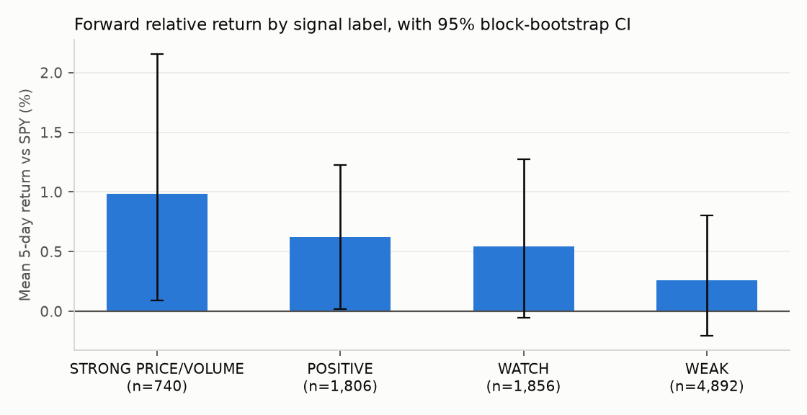
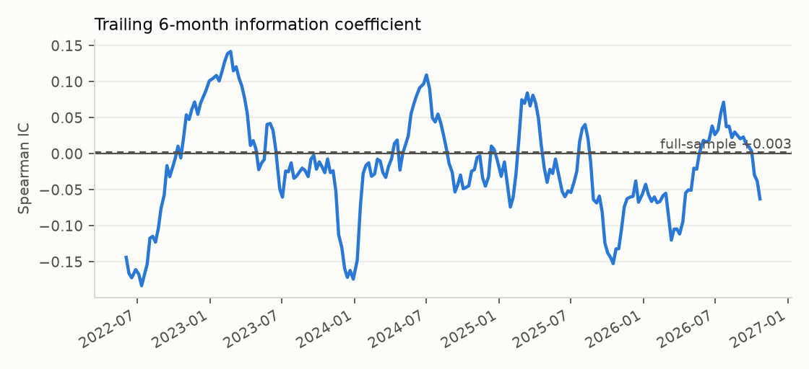
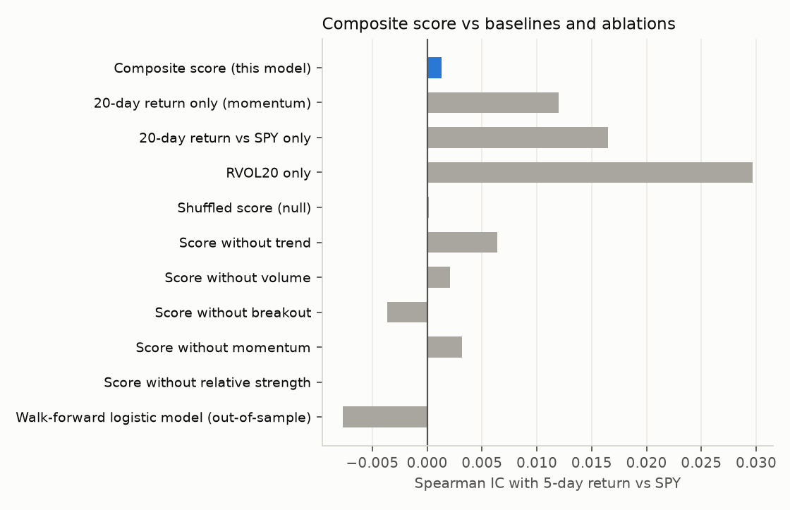

# Does the score predict anything?

The daily monitor describes how well price, volume and trend line up today. This page
tests a stronger claim: **is a higher score at today's close followed by better
performance relative to the S&P 500 over the next 5 trading days?**

## Summary

*Last evaluated 2026-11-06 on 14,860 ticker-days (2021-12-07 to 2026-10-29), 5-day horizon, data: yahoo.*

| Metric | Estimate | 95% CI |
|---|---:|---:|
| Rank IC: score vs forward return over SPY | +0.001 | [-0.041, +0.040] |
| Rank IC, non-overlapping windows only | -0.007 | |
| Mean return gap: POSITIVE-or-better minus WEAK | +0.36% | [-0.24%, +0.86%] |
| Out-of-sample AUC: hand weights vs learned weights | 0.497 vs 0.505 | |

The 95% interval for the IC includes zero, so the data do not support a claim that the score predicts forward relative returns. That is a legitimate finding: the score is useful as a description of today's move, not as a forecast.

## Setup

- **Universe:** ALAB, AMD, AMZN, CEG, ETN, FSLR, GEV, GOOG, IBM, MRVL, NVDA, SKHY, SPCX, TSLA, VST; benchmark SPY.
- **Sample:** 1,229 trading days, 14,860 ticker-days with a full score.
  Rows labelled *INSUFFICIENT DATA* (too little history, e.g. right after an IPO) are excluded.
- **Target:** 5-day forward return minus SPY's forward return over the same days.
- **No look-ahead:** every indicator at day *t* uses data through the close of *t* only;
  this is enforced by a unit test that perturbs future prices.
- **Uncertainty:** forward windows overlap and stocks move together, so observations are not
  independent. Confidence intervals use a moving-block bootstrap that resamples 20-day blocks
  of dates, keeping both serial and cross-sectional correlation intact.

## Returns by signal label

| label | n | mean | ci_lo | ci_hi | median | hit_rate |
|---|---:|---:|---:|---:|---:|---:|
| STRONG PRICE/VOLUME | 1,226 | +0.84% | +0.10% | +1.64% | +0.45% | 54.0% |
| POSITIVE | 3,126 | +0.65% | +0.23% | +1.10% | +0.25% | 52.5% |
| WATCH | 3,142 | +0.35% | -0.08% | +0.83% | +0.13% | 51.1% |
| WEAK | 7,366 | +0.35% | -0.03% | +0.81% | +0.13% | 51.4% |

## Stability

The full-sample IC can hide periods where the relationship flips sign.

| year | n | ic |
|---|---:|---:|
| 2021 | 180 | +0.188 |
| 2022 | 2,720 | +0.028 |
| 2023 | 2,750 | -0.075 |
| 2024 | 3,120 | +0.043 |
| 2025 | 3,250 | -0.001 |
| 2026 | 2,840 | -0.076 |

By ticker:

| ticker | n | ic | first_date |
|---|---:|---:|---:|
| ALAB | 636 | +0.107 | 2024-04-18 |
| AMD | 1,229 | +0.032 | 2021-12-07 |
| AMZN | 1,229 | -0.099 | 2021-12-07 |
| CEG | 1,170 | +0.012 | 2022-03-03 |
| ETN | 1,229 | -0.046 | 2021-12-07 |
| FSLR | 1,229 | -0.049 | 2021-12-07 |
| GEV | 628 | -0.015 | 2024-04-30 |
| GOOG | 1,229 | -0.001 | 2021-12-07 |
| IBM | 1,229 | +0.029 | 2021-12-07 |
| MRVL | 1,229 | -0.039 | 2021-12-07 |
| NVDA | 1,229 | -0.030 | 2021-12-07 |
| SKHY | 59 | -0.314 | 2026-08-07 |
| SPCX | 77 | +0.057 | 2026-07-14 |
| TSLA | 1,229 | +0.032 | 2021-12-07 |
| VST | 1,229 | +0.023 | 2021-12-07 |

## Baselines and ablation

A composite only earns its complexity if it beats its simplest ingredients. Each ablation row
re-scores the full history with one component removed and the rest re-weighted to 100.

| signal | ic |
|---|---:|
| Composite score (this model) | +0.001 |
| 20-day return only (momentum) | +0.011 |
| 20-day return vs SPY only | +0.016 |
| RVOL20 only | +0.030 |
| Shuffled score (null) | +0.004 |

| removed | ic | change |
|---|---:|---:|
| trend | +0.006 | +0.005 |
| volume | +0.002 | +0.001 |
| breakout | -0.004 | -0.005 |
| momentum | +0.003 | +0.002 |
| relative_strength | -0.000 | -0.001 |

A negative *change* means removing the component hurts, i.e. it was contributing.

## Hand-chosen vs learned weights

The 25/25/20/15/15 weights were set by judgement. To check whether data would choose
differently, a logistic regression on the five component scores is refit every quarter on an
expanding window and used only to score later dates. A 5-day gap separates
each training cut-off from the test period so overlapping targets cannot leak.

Out-of-sample period: 2022-12-07 onward, 12,147 ticker-days.

| Model | AUC (target: beats SPY) | Spearman IC |
|---|---:|---:|
| Hand-weighted score | 0.497 | -0.009 |
| Walk-forward logistic regression | 0.505 | -0.008 |

Learning the weights from data does not beat the hand-chosen weights out of sample. With this little data, the simpler fixed-weight model is preferable.

## Limitations

- 15 stocks is a small, concentrated, highly correlated universe. Results may not
  generalise to other sectors or periods. Recent listings contribute only a few months of data.
- Several baselines, ablations and a model are compared on the same data. Treat any single
  small difference as noise unless it holds up out of sample.
- Yahoo Finance adjusted prices; no transaction costs, no survivorship-bias control.
- A positive IC is a statistical association, not a trading strategy and not evidence of
  institutional buying.
