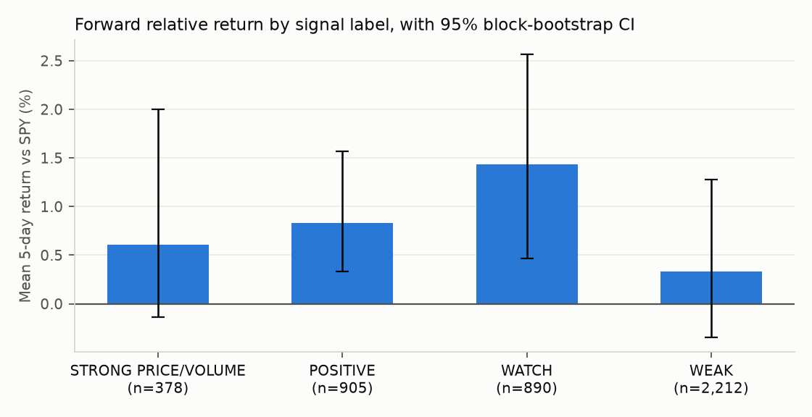
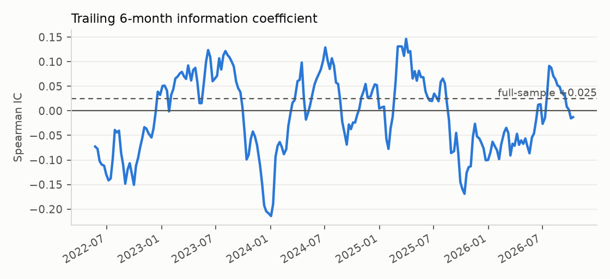
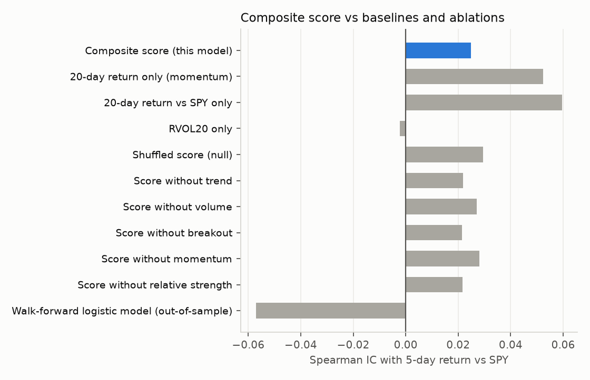

# Does the score predict anything?

The daily monitor describes how well price, volume and trend line up today. This page
tests a stronger claim: **is a higher score at today's close followed by better
performance relative to the S&P 500 over the next 5 trading days?**

## Summary

*Last evaluated 2026-10-24 on 4,385 ticker-days (2021-11-22 to 2026-10-16), 5-day horizon, data: yahoo.*

| Metric | Estimate | 95% CI |
|---|---:|---:|
| Rank IC: score vs forward return over SPY | +0.025 | [-0.041, +0.079] |
| Rank IC, non-overlapping windows only | -0.014 | |
| Mean return gap: POSITIVE-or-better minus WEAK | +0.43% | [-0.58%, +1.34%] |
| Out-of-sample AUC: hand weights vs learned weights | 0.502 vs 0.470 | |

The 95% interval for the IC includes zero, so the data do not support a claim that the score predicts forward relative returns. That is a legitimate finding: the score is useful as a description of today's move, not as a forecast.

## Setup

- **Universe:** ALAB, KLAC, SPCX, TSLA, VRT; benchmark SPY.
- **Sample:** 1,230 trading days, 4,385 ticker-days with a full score.
  Rows labelled *INSUFFICIENT DATA* (too little history, e.g. right after an IPO) are excluded.
- **Target:** 5-day forward return minus SPY's forward return over the same days.
- **No look-ahead:** every indicator at day *t* uses data through the close of *t* only;
  this is enforced by a unit test that perturbs future prices.
- **Uncertainty:** forward windows overlap and stocks move together, so observations are not
  independent. Confidence intervals use a moving-block bootstrap that resamples 20-day blocks
  of dates, keeping both serial and cross-sectional correlation intact.

## Returns by signal label

| label | n | mean | ci_lo | ci_hi | median | hit_rate |
|---|---:|---:|---:|---:|---:|---:|
| STRONG PRICE/VOLUME | 378 | +0.61% | -0.14% | +2.00% | +0.28% | 50.8% |
| POSITIVE | 905 | +0.83% | +0.33% | +1.57% | +0.34% | 53.6% |
| WATCH | 890 | +1.44% | +0.47% | +2.57% | +1.03% | 56.3% |
| WEAK | 2,212 | +0.33% | -0.35% | +1.28% | +0.25% | 51.6% |

## Stability

The full-sample IC can hide periods where the relationship flips sign.

| year | n | ic |
|---|---:|---:|
| 2021 | 84 | +0.052 |
| 2022 | 753 | -0.006 |
| 2023 | 750 | -0.074 |
| 2024 | 934 | +0.067 |
| 2025 | 1,000 | -0.008 |
| 2026 | 864 | +0.016 |

By ticker:

| ticker | n | ic | first_date |
|---|---:|---:|---:|
| ALAB | 627 | +0.106 | 2024-04-18 |
| KLAC | 1,230 | -0.122 | 2021-11-22 |
| SPCX | 68 | -0.025 | 2026-07-14 |
| TSLA | 1,230 | +0.033 | 2021-11-22 |
| VRT | 1,230 | +0.036 | 2021-11-22 |

## Baselines and ablation

A composite only earns its complexity if it beats its simplest ingredients. Each ablation row
re-scores the full history with one component removed and the rest re-weighted to 100.

| signal | ic |
|---|---:|
| Composite score (this model) | +0.025 |
| 20-day return only (momentum) | +0.052 |
| 20-day return vs SPY only | +0.060 |
| RVOL20 only | -0.002 |
| Shuffled score (null) | +0.029 |

| removed | ic | change |
|---|---:|---:|
| trend | +0.022 | -0.003 |
| volume | +0.027 | +0.002 |
| breakout | +0.022 | -0.003 |
| momentum | +0.028 | +0.003 |
| relative_strength | +0.022 | -0.003 |

A negative *change* means removing the component hurts, i.e. it was contributing.

## Hand-chosen vs learned weights

The 25/25/20/15/15 weights were set by judgement. To check whether data would choose
differently, a logistic regression on the five component scores is refit every quarter on an
expanding window and used only to score later dates. A 5-day gap separates
each training cut-off from the test period so overlapping targets cannot leak.

Out-of-sample period: 2022-11-22 onward, 3,629 ticker-days.

| Model | AUC (target: beats SPY) | Spearman IC |
|---|---:|---:|
| Hand-weighted score | 0.502 | +0.019 |
| Walk-forward logistic regression | 0.470 | -0.057 |

Learning the weights from data does not beat the hand-chosen weights out of sample. With this little data, the simpler fixed-weight model is preferable.

## Limitations

- Five stocks is a small, concentrated, highly correlated universe. Results may not
  generalise to other sectors or periods.
- Several baselines, ablations and a model are compared on the same data. Treat any single
  small difference as noise unless it holds up out of sample.
- Yahoo Finance adjusted prices; no transaction costs, no survivorship-bias control.
- A positive IC is a statistical association, not a trading strategy and not evidence of
  institutional buying.
