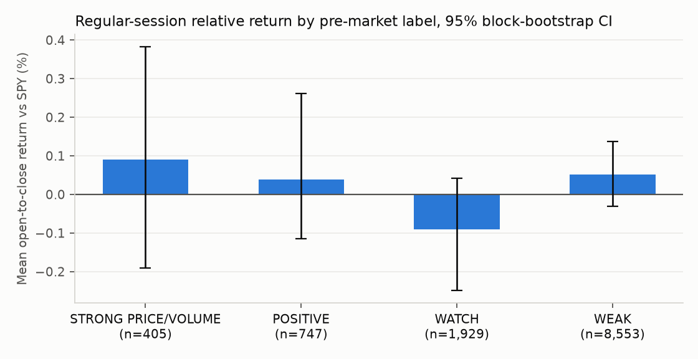

# Does the pre-market score predict the regular session?

The [pre-market snapshot](premarket.md) describes how each stock is trading before the open.
This page tests whether that description carries information about what happens next:
**is a higher pre-market score followed by a better return from the 09:30 open to the 16:00
close, relative to SPY over the same hours?**

## Summary

*Last evaluated 2026-11-21 on 11,666 ticker-days (2023-11-22 to 2026-11-20), pre-market bars through 08:30 ET, data: alpaca-sip.*

| Metric | Estimate | 95% CI |
|---|---:|---:|
| Rank IC: pre-market score vs open-to-close return over SPY | -0.025 | [-0.055, -0.003] |
| Mean return gap: POSITIVE-or-better minus WEAK | +0.03% | [-0.17%, +0.20%] |
| Rank IC: gap vs SPY alone (negative = gaps fade) | -0.012 | |

The 95% interval is entirely below zero: strong pre-market setups have tended to *underperform* SPY after the open, consistent with gaps fading during the session.

## Setup

- **Universe:** ALAB, AMD, AMZN, BE, CEG, DELL, ETN, FSLR, GEV, GOOG, IBM, MRVL, NVDA, SKHY, SPCX, TSLA, TSM, VST; benchmark SPY.
- **Sample:** 752 trading days, 11,666 ticker-days with a full pre-market score.
  0 ticker-days with a gap larger than 40% were dropped as
  likely data errors or corporate actions.
- **Data:** Alpaca SIP feed (trades from every U.S. exchange), 30-minute bars over about 3 years, split-adjusted. Includes pre-market volume.
- **Snapshot time:** pre-market bars that closed by 08:30 ET, the same
  snapshot the [daily pre-market page](premarket.md) shows.
- **Target:** open-to-close return minus SPY's open-to-close return. It begins after every input is
  known, so there is no look-ahead. Daily context comes from the previous completed session.
- **Uncertainty:** one-day targets do not overlap, but stocks move together within a day, so
  intervals come from a block bootstrap over dates.

## Returns by pre-market label

| label | n | mean | ci_lo | ci_hi | median | hit_rate |
|---|---:|---:|---:|---:|---:|---:|
| STRONG PRICE/VOLUME | 405 | +0.08% | -0.20% | +0.37% | -0.12% | 47.2% |
| POSITIVE | 730 | +0.06% | -0.13% | +0.26% | +0.02% | 50.4% |
| WATCH | 1,924 | -0.10% | -0.25% | +0.03% | -0.05% | 48.8% |
| WEAK | 8,607 | +0.03% | -0.03% | +0.13% | -0.03% | 49.4% |

## Baselines

| signal | ic |
|---|---:|
| Pre-market score (this model) | -0.025 |
| Gap vs SPY only | -0.012 |
| Gap / ATR only | -0.011 |
| Pre-market RVOL only | +0.000 |
| Prior close end-of-day score only | -0.021 |
| Shuffled score (null) | +0.007 |

The gap rows answer a classic market-microstructure question directly: a negative IC means
pre-market moves have tended to reverse after the open (gap fade); a positive IC means they
have tended to extend (gap continuation).

## Ablation

| removed | ic | change |
|---|---:|---:|
| gap | -0.022 | +0.003 |
| volume | -0.019 | +0.006 |
| level | -0.029 | -0.004 |
| context | -0.019 | +0.006 |

A negative *change* means removing the component lowers the IC, i.e. it was contributing.

## By ticker

| ticker | n | ic | mean_gap_abs |
|---|---:|---:|---:|
| ALAB | 652 | -0.006 | 2.07% |
| AMD | 752 | +0.022 | 1.54% |
| AMZN | 752 | -0.029 | 0.80% |
| BE | 751 | -0.007 | 2.07% |
| CEG | 682 | -0.006 | 1.09% |
| DELL | 747 | -0.052 | 1.41% |
| ETN | 563 | -0.076 | 1.08% |
| FSLR | 741 | -0.029 | 1.10% |
| GEV | 640 | -0.079 | 1.25% |
| GOOG | 752 | -0.026 | 0.79% |
| IBM | 738 | +0.002 | 0.64% |
| MRVL | 752 | -0.047 | 1.83% |
| NVDA | 752 | -0.062 | 1.18% |
| SKHY | 81 | +0.024 | 3.01% |
| SPCX | 99 | +0.004 | 1.51% |
| TSLA | 752 | -0.034 | 1.27% |
| TSM | 752 | -0.101 | 1.26% |
| VST | 708 | -0.016 | 1.31% |

## Limitations

- A few years of history for a handful of stocks; SPCX and SKHY add only a few months.
- Intraday prices are not dividend-adjusted; on ex-dividend days the measured gap includes the
  dividend. The effect is small for this universe.
- Open-to-close returns ignore the cost of trading at the open, when spreads are widest.
- 18 correlated stocks; several comparisons on the same data. Not investment advice.
