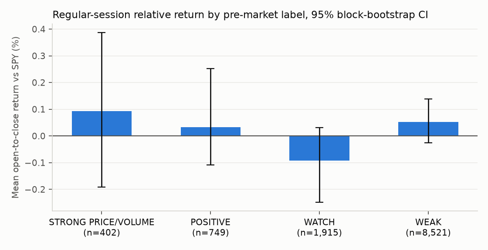

# Does the pre-market score predict the regular session?

The [pre-market snapshot](premarket.md) describes how each stock is trading before the open.
This page tests whether that description carries information about what happens next:
**is a higher pre-market score followed by a better return from the 09:30 open to the 16:00
close, relative to SPY over the same hours?**

## Summary

*Last evaluated 2026-11-10 on 11,587 ticker-days (2023-11-13 to 2026-11-09), pre-market bars through 08:30 ET, data: alpaca-sip.*

| Metric | Estimate | 95% CI |
|---|---:|---:|
| Rank IC: pre-market score vs open-to-close return over SPY | -0.029 | [-0.056, -0.005] |
| Mean return gap: POSITIVE-or-better minus WEAK | +0.00% | [-0.17%, +0.20%] |
| Rank IC: gap vs SPY alone (negative = gaps fade) | -0.010 | |

The 95% interval is entirely below zero: strong pre-market setups have tended to *underperform* SPY after the open, consistent with gaps fading during the session.

## Setup

- **Universe:** ALAB, AMD, AMZN, BE, CEG, DELL, ETN, FSLR, GEV, GOOG, IBM, MRVL, NVDA, SKHY, SPCX, TSLA, TSM, VST; benchmark SPY.
- **Sample:** 750 trading days, 11,587 ticker-days with a full pre-market score.
  0 ticker-days with a gap larger than 40% were dropped as
  likely data errors or corporate actions.
- **Data:** Alpaca SIP feed (trades from every U.S. exchange), 30-minute bars over about 3 years, split-adjusted. Includes pre-market volume.
- **Snapshot time:** pre-market bars that closed by 08:30 ET, the same
  snapshot the [daily pre-market page](premarket.md) shows.
- **Target:** open-to-close return minus SPY's open-to-close return. It begins after every input is
  known, so there is no look-ahead. Daily context comes from the previous completed session.
- **Uncertainty:** one-day targets do not overlap, but stocks move together within a day, so
  intervals come from a block bootstrap over dates.

## Returns by pre-market label

| label | n | mean | ci_lo | ci_hi | median | hit_rate |
|---|---:|---:|---:|---:|---:|---:|
| STRONG PRICE/VOLUME | 402 | +0.09% | -0.19% | +0.39% | -0.09% | 47.5% |
| POSITIVE | 749 | +0.03% | -0.11% | +0.25% | -0.01% | 49.7% |
| WATCH | 1,915 | -0.09% | -0.25% | +0.03% | -0.05% | 48.7% |
| WEAK | 8,521 | +0.05% | -0.02% | +0.14% | -0.01% | 49.7% |

## Baselines

| signal | ic |
|---|---:|
| Pre-market score (this model) | -0.029 |
| Gap vs SPY only | -0.010 |
| Gap / ATR only | -0.009 |
| Pre-market RVOL only | +0.001 |
| Prior close end-of-day score only | -0.029 |
| Shuffled score (null) | -0.006 |

The gap rows answer a classic market-microstructure question directly: a negative IC means
pre-market moves have tended to reverse after the open (gap fade); a positive IC means they
have tended to extend (gap continuation).

## Ablation

| removed | ic | change |
|---|---:|---:|
| gap | -0.028 | +0.001 |
| volume | -0.025 | +0.005 |
| level | -0.032 | -0.003 |
| context | -0.020 | +0.009 |

A negative *change* means removing the component lowers the IC, i.e. it was contributing.

## By ticker

| ticker | n | ic | mean_gap_abs |
|---|---:|---:|---:|
| ALAB | 643 | -0.007 | 2.04% |
| AMD | 750 | +0.014 | 1.52% |
| AMZN | 750 | -0.023 | 0.80% |
| BE | 749 | -0.011 | 2.04% |
| CEG | 677 | -0.012 | 1.09% |
| DELL | 744 | -0.066 | 1.37% |
| ETN | 556 | -0.076 | 1.06% |
| FSLR | 739 | -0.039 | 1.10% |
| GEV | 631 | -0.084 | 1.22% |
| GOOG | 750 | -0.025 | 0.79% |
| IBM | 736 | +0.001 | 0.64% |
| MRVL | 750 | -0.052 | 1.79% |
| NVDA | 750 | -0.070 | 1.16% |
| SKHY | 72 | +0.006 | 2.90% |
| SPCX | 90 | +0.087 | 1.48% |
| TSLA | 750 | -0.030 | 1.26% |
| TSM | 750 | -0.108 | 1.23% |
| VST | 700 | -0.020 | 1.30% |

## Limitations

- A few years of history for a handful of stocks; SPCX and SKHY add only a few months.
- Intraday prices are not dividend-adjusted; on ex-dividend days the measured gap includes the
  dividend. The effect is small for this universe.
- Open-to-close returns ignore the cost of trading at the open, when spreads are widest.
- 18 correlated stocks; several comparisons on the same data. Not investment advice.
